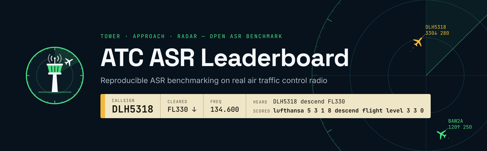

  

# ATC ASR

Open evaluation of automatic speech recognition on **air traffic control** radio.

ATC speech is narrow-band VHF, mostly non-native English, and dense with numbers and callsigns. This organization keeps the benchmark, the evaluation code, and the published scores in one place.

## Leaderboard

The [ATC ASR Leaderboard](https://huggingface.co/spaces/atc-asr/leaderboard) ranks open and commercial systems on ATC test sets.

- **WER** after ATC normalization, with a 95% bootstrap confidence interval
- **NumER**, the error rate on digit tokens: flight levels, headings, frequencies, squawks
- **RTFx** for local models on one fixed GPU

Models fine-tuned on a test set are marked. Those scores are shown and are not treated as comparable.

## Tracks

| Track | Sets | What is published |
|---|---|---|
| Public | ATCO2 1h, UWB-ATCC, ATCOSIM | Public audio. Scores and code can be reproduced. |
| Private | ATCO2 4h (ELDA), LDC-ATCC | Aggregate scores only. Audio and transcripts stay local. |

References are spoken form. The normalizer maps written outputs such as `FL330` and `DLH5318` onto the same canonical form as the reference.

## Code

Evaluation toolkit: [atc-asr/leaderboard](https://github.com/atc-asr/leaderboard) (`atcbench`, Apache-2.0).

To add a model, open a pull request with a `configs/models.yaml` entry and the `*.summary.json` files. Maintainers re-run on the reference GPU before merging.

Idiap Research Institute, Switzerland.
